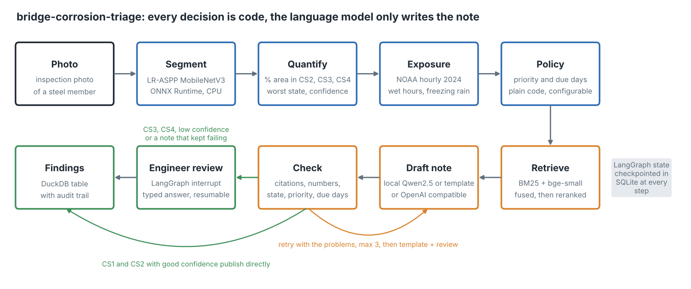
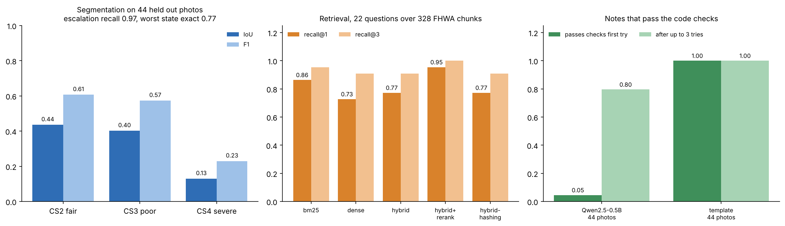
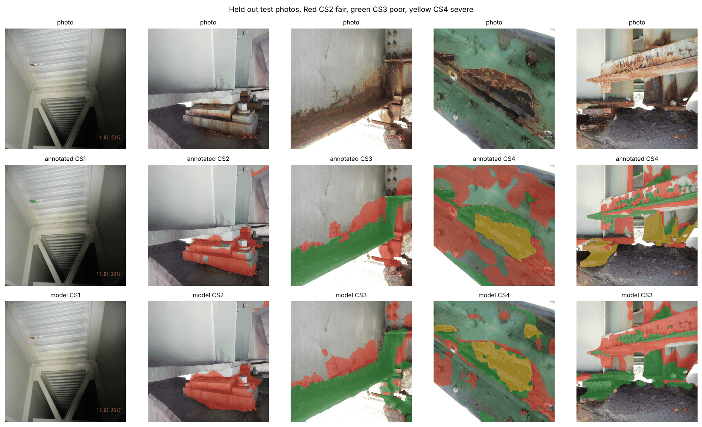

# bridge-corrosion-triage


Takes a photo of a steel bridge member and turns it into an inspection finding: how much of
it is in each corrosion condition state, how wet and salty the site is, what should be done
and by when, a short note that cites FHWA guidance, and a sign-off by an engineer when the
finding is serious. Runs on a laptop CPU, no GPU, no API keys.



## The problem

Bridge inspectors in the US record steel corrosion as element condition states: CS1 good,
CS2 fair (surface rust), CS3 poor (pack rust, section loss starting) and CS4 severe
(perforation, section loss that may affect capacity). Each state carries a different action
and a different deadline. Today a person looks at hundreds of photos per bridge, decides the
state by eye and types the note.

Detecting rust in a photo is the easy part and has been done many times. The parts that make
it usable in an inspection record are less common:

- turn pixels into the quantity the record needs (share of area per condition state),
- take the site into account, because the same rust on a bridge that stays wet most of the
  year or gets deicing salt every winter is a different risk,
- keep the decision (priority, due date, who has to look) out of the language model,
- make sure the note never invents a number or a reference,
- let an engineer approve or change the finding later, from another machine, without losing
  the state of the run.

## Why now

- **Drones and AI for bridge condition are moving into rail and road operations.** On
  6 October 2026 the Porto engineering school (ISEP) described Digi4RailBridges, which feeds
  drone images and sensor data into a digital twin of each railway bridge on Portugal's
  North Line to predict deterioration and act earlier, with extreme weather as an explicit
  driver ([Portugal Resident, 6 Oct 2026](https://portugalresident.com/porto-researchers-use-ai-and-drones-to-spot-railway-bridge-defects)).
- **Corrosion segmentation is getting finer, but stops at the mask.** A two level SegFormer
  and Mask2Former framework from Saitama University, published online in August 2026 in
  Computer-Aided Civil and Infrastructure Engineering, separates corrosion patterns on
  Japanese steel bridges. Its own summary notes that it was not evaluated on edge hardware and
  does not measure section loss ([summary, 15 Sep 2026](https://www.progressiverobot.com/2026/09/15/two-level-ai-framework-steel-bridge-corrosion-inspection/)).
  This repo takes the other side of that trade: a small model on a CPU and the decision layer
  around it.
- **Human review in agent frameworks became typed.** LangGraph 1.2.12 (21 September 2026)
  added `response_schema` to `interrupt()`, so a paused run tells the client what answer it
  expects and rejects a malformed one
  ([release notes](https://releases.sh/langchain/langgraph-releases.md)). That is exactly what
  an engineer sign-off needs.

## How it works

| Stage | What goes in | What comes out | Tooling |
|---|---|---|---|
| Segment | inspection photo | per pixel class: background, CS2, CS3, CS4 | LR-ASPP MobileNetV3 fine-tuned in PyTorch, exported to ONNX, run with ONNX Runtime |
| Quantify | mask and pixel probabilities | % of photo per state, worst state above a 0.5% noise floor, mean confidence | NumPy |
| Exposure | site name | wet hours a year (RH at or above 80% and above 0 C), ISO 9223 time of wetness band, freeze-thaw days, freezing precipitation days, exposure class | NOAA Local Climatological Data, hourly |
| Policy | worst state, exposure, confidence | priority P1 to P4, due days, whether an engineer must review | plain Python, table in `config.yaml` |
| Retrieve | query built from the state and action | 4 guidance passages, each tagged with document and page | BM25 + bge-small-en-v1.5, reciprocal rank fusion, ms-marco MiniLM cross-encoder, all through fastembed on CPU |
| Draft | facts and passages | 2 to 4 sentence note | template, local Qwen2.5 with transformers, or any OpenAI compatible endpoint |
| Check | note | list of problems | code: citations must be retrieved pages, numbers must be facts, state, priority and due days present, no worse state mentioned |
| Retry or fall back | problems | new note, or template note plus review after 3 tries | LangGraph conditional edges |
| Review | paused state | approve, edit or reject, typed and validated | LangGraph `interrupt(response_schema=...)`, SQLite checkpointer |
| Publish | final state | one row per photo with the audit trail | DuckDB, upsert by thread id |

Why each tool is there: [ADR 0001](docs/adr-0001-segmentation-on-cpu.md) (segmentation on
CPU), [ADR 0002](docs/adr-0002-langgraph-review-loop.md) (LangGraph and the review loop),
[ADR 0003](docs/adr-0003-hybrid-retrieval.md) (retrieval).

## Results

Everything below comes from runs in this repo on 12 October 2026, on a two core cloud VM
with no GPU. Raw numbers are in `results/`.



### Segmentation (44 held out test photos, never used for training or model selection)

Trained for 30 epochs on 357 photos at 320 x 320, best epoch picked on 39 validation photos
(about 43 minutes of wall time on two CPU threads).

| | IoU | F1 |
|---|---:|---:|
| background and CS1 | 0.895 | 0.945 |
| CS2 fair | 0.436 | 0.607 |
| CS3 poor | 0.402 | 0.574 |
| CS4 severe | 0.130 | 0.230 |
| mean | 0.466 | 0.589 |

Pixel F1 weighted by class frequency is 0.866. The dataset authors report 86.67 for
DeepLabV3+; I would not read that as parity, their averaging may differ and their model is
much heavier. CS4 is the weak class: it is under 3% of training pixels and visually close to
CS3.



The last column is one of the CS4 photos the model calls CS3: it sees the corrosion but not
the section loss.

What matters for triage is the photo level decision:

- Worst state exactly right on 34 of 44 photos (77%), off by at most one state on all 44.
- Photos that need an engineer (worst state CS3 or CS4): 36 of 37 caught (97.3% recall),
  and 36 of 37 flagged photos really needed it (97.3% precision). The one miss has 0.78%
  of its area in CS3, just above the 0.5% floor, and the model saw none.
- 5 of 11 CS4 photos came out as CS3. They still go to an engineer, but with priority P2 and
  120 days instead of P1 and 30 days. The reviewer can raise the priority in the review
  answer, and this is the first thing I would fix (see below).
- Area share error: 4.5 percentage points of corroded area on average.
- Inference: 13.6 ms median per photo, 16.0 ms p95, ONNX Runtime with two threads.

### Retrieval (22 questions, page level relevance, 328 chunks from 3 FHWA documents)

| Mode | recall@1 | recall@3 | MRR@10 | ms per query |
|---|---:|---:|---:|---:|
| BM25 | 0.86 | 0.95 | 0.92 | 0.5 |
| dense (bge-small) | 0.73 | 0.91 | 0.82 | 47.2 |
| BM25 + dense, RRF | 0.77 | 0.91 | 0.86 | 50.5 |
| RRF + cross-encoder rerank (default) | 0.95 | 1.00 | 0.98 | 1,204.5 |
| BM25 + hashing vectors (offline, CI) | 0.77 | 0.91 | 0.84 | 0.5 |

BM25 alone beats dense vectors here, and plain fusion does not help. The reranker is the
only step that beats BM25, at about 1.2 s per query on two threads. It runs once per
photo, so it is the default. The questions were written by me from the documents, so they
share vocabulary with them; that favours BM25 and is a reason to read these numbers as a
comparison between modes, not as absolute quality.

### Notes written by language models (44 photos, annotated masks, Richmond site)

The masks are the annotated ones here, so the only thing that changes between rows is the
model that writes the note.

| Writer | passes checks first try | after up to 3 tries | mean tries | replaced by template | median per photo |
|---|---:|---:|---:|---:|---:|
| template | 44 of 44 | 44 of 44 | 1.0 | 0 | 1.1 s |
| Qwen2.5-0.5B, prompt v1 | 3 of 44 | 6 of 44 | 2.8 | 38 | 67.6 s |
| Qwen2.5-0.5B, prompt v2 | 0 of 44 | 0 of 44 | 3.0 | 44 | 66.3 s |
| Qwen2.5-0.5B, prompt v3 (shipped) | 2 of 44 | 35 of 44 | 2.36 | 9 | 52.8 s |

The prompt took three versions and the checks are what showed it:

1. **v1** gave a fixed example tag in the instructions. The 0.5B model copied that example
   into most notes instead of citing what was retrieved (85 rejections for citing a page that
   was not retrieved).
2. **v2** removed the example. The model then stopped citing at all and pulled numbers from
   the excerpts into the note (130 notes without a citation, 117 with invented numbers).
3. **v3** uses the tag of the first retrieved excerpt as the example, so copying it is
   correct. First tries still fail (2 of 44 pass), mostly by leaving out the priority code,
   but with the list of problems fed back, 35 of 44 pass within three tries.

Passing the checks is necessary, not sufficient. Notes from the 0.5B model that pass are
still often in markdown, cut off at the token limit, call CS3 rust "severe corrosion" in
words, and repeat details from the guidance (for example "under an open grid deck") that
are not in the photo. The checks catch numbers, references, state codes and deadlines, not
wording. For the record itself I would keep the template, use the model note only as a
draft for the reviewer, or use a larger model. I tried Qwen2.5-1.5B at fp32, and it did not
fit in memory next to the retrieval models on this 8 GB VM, so it is not measured.

Nothing here can change a decision: in every row the priority, due days and review flag are
the same, because they come from the policy table.

### End to end with the model

The same 44 photos through the ONNX model, the template writer and the reranker: 37 of 44
(84%) paused for an engineer, which matches the test set (37 photos have CS3 or CS4).
Median 1.1 s per photo, almost all of it the cross-encoder.

## Run it

Python 3.10 to 3.13. No accounts, no keys, no GPU.

```bash
pip install -e ".[dev]"

# offline, seconds: 8 bundled photos, annotated masks, BM25, template notes
bridge-triage demo
pytest -q
```

```
    2.jpeg richmond-inland  CS4 P1   30d  corroded 30.92%  REVIEW
    5.jpeg roanoke-valley   CS3 P2  120d  corroded 14.06%  REVIEW
   10.jpeg norfolk-harbor   CS2 P3  180d  corroded   2.4%  auto
   ...
   21.jpeg richmond-inland  CS1 P4  730d  corroded  0.12%  auto
```

Full pipeline:

```bash
pip install torch torchvision --index-url https://download.pytorch.org/whl/cpu
pip install -e ".[train,llm]"

bridge-triage fetch                      # dataset (333 MB), FHWA PDFs, corpus
bridge-triage train                      # about 45 min on 2 CPU threads, writes data/model/
bridge-triage inspect sample_data/images/24.jpeg --site roanoke-valley
bridge-triage review <thread-id> --decision approve --reviewer "your name"
bridge-triage findings

bridge-triage evaluate vision
bridge-triage evaluate retrieval
bridge-triage evaluate agent --provider hf --model Qwen/Qwen2.5-0.5B-Instruct
bridge-triage report                     # rebuilds docs/*.png
```

`inspect` stops at the review step when the policy asks for it and prints the thread id.
`review` can run later, from another shell: the run is restored from the SQLite checkpoint.
To use another model for the notes, set `TRIAGE_PROVIDER=openai` and the variables in
`.env.example` (works with a local Ollama).

## Data

| Source | Used for | Licence |
|---|---|---|
| [Corrosion Condition State Semantic Segmentation Dataset](https://doi.org/10.7294/16624663), Bianchi and Hebdon, Virginia Tech, 440 photos from Virginia DOT inspection reports annotated with AASHTO condition states | training and test | CC0 |
| [NOAA NCEI Local Climatological Data](https://www.ncei.noaa.gov/access/services/data/v1), hourly, 2024, Richmond (72401013740), Norfolk (72308013737) and Roanoke (72411013741) airports | site exposure | US government work, public domain |
| FHWA [Steel Bridge Design Handbook: Corrosion Protection of Steel Bridges](https://rosap.ntl.bts.gov/view/dot/42715) (FHWA-HIF-16-002), [Bridge Preservation Guide](https://rosap.ntl.bts.gov/view/dot/41105) (2018), [Prioritizing Preservation for Locally Owned Bridges](https://www.fhwa.dot.gov/bridge/preservation/docs/hif22046.pdf) (FHWA-HIF-22-046) | guidance corpus | US government works, public domain |

All downloaded on 12 October 2026 by `bridge-triage fetch` (NOAA files with
`data.fetch_weather`). Nothing is synthetic, except small fixtures inside the unit tests.

Bundled so the demo and CI run offline: 8 test photos and their masks downsized to
256 px (`sample_data/images`, `sample_data/masks`), the hourly weather of the three stations
reduced to the needed columns (`sample_data/weather`), the guidance corpus as page anchored
chunks with author contact details removed (`sample_data/fhwa_chunks.jsonl`) and the 22
retrieval questions. Trained weights are not in the repo; `bridge-triage train` rebuilds them.

The three sites in `config.yaml` are examples. The photos come from Virginia inspection
reports, so the weather comes from Virginia airports, but no photo is tied to a real bridge
and the marine flag on `norfolk-harbor` is an assumption to show how the policy reacts.

Dataset citation: Bianchi, E. and Hebdon, M. (2021). Corrosion Condition State Semantic
Segmentation Dataset. University Libraries, Virginia Tech. doi:10.7294/16624663.

## Repository layout

```
config.yaml            model, retrieval, provider, policy and example sites
src/bridge_triage/
  segment.py           mask decoding, ONNX inference, condition state quantities
  train.py             LR-ASPP fine-tuning and ONNX export (train extra)
  exposure.py          NOAA hourly to wet hours, freeze-thaw, exposure class
  policy.py            priority, due days and review rules
  corpus.py            FHWA PDFs to page anchored chunks
  retrieval.py         BM25, dense, RRF, cross-encoder, offline hashing embedder
  llm.py               template, local transformers and OpenAI compatible providers
  guardrail.py         checks on the generated note
  agent.py             the LangGraph workflow and the typed review answer
  store.py             DuckDB findings table
  pipeline.py          wiring, SQLite checkpointer, run and resume
  experiments.py       the measured runs behind this README
  evaluate.py          metrics
  report.py            figures
  data.py              downloads and sample building
  cli.py               fetch, train, inspect, review, findings, demo, evaluate, report
tests/                 41 tests, no network, no model download
docs/                  ADRs and figures
results/               metrics of the runs in this README
sample_data/           real sample for the offline demo and CI
```

## Limitations

- Percentages are of the photo, not of the element. An inspector reports a share of the
  girder or the bearing; that needs the element outline and scale, which one photo does not
  give. The SEOULTECH work on aligning repeat drone images to a 3D reference
  ([Highways Today, 21 Aug 2026](https://highways.today/2026/08/21/drone-inspections-for-bridges/))
  is the kind of step that would close this gap.
- CS4 is under-segmented (IoU 0.13). The policy sends CS3 to an engineer too, so this costs
  priority, not safety, on this test set. With 11 CS4 test photos the estimate is noisy.
- The test set has 1 CS1 photo and 6 CS2 photos. The auto publish path is tested in code
  but its accuracy is not well measured.
- The policy table and the exposure thresholds are reasonable defaults I chose, not values
  from AASHTO or FHWA. They are in `config.yaml` for an owner to set.
- Exposure uses one year of airport weather. A bridge over water, under a deck joint or in a
  splash zone has its own microclimate, which the handbook stresses and this does not model.
- Photos come from one state's reports. Different cameras, coatings and lighting will move
  the model, and I would recalibrate the confidence threshold on local photos first.
- The retrieval questions and the policy were written by the same person as the code.

## What I would do next

- Train with a loss that cares about the worst state (for example a higher weight or a
  separate photo level head for CS4), and report recall on CS4 photos as the main metric.
- Calibrate the confidence that sends photos to review on held out data, instead of a fixed
  0.75.
- Track the same member across inspections and store the condition state history, so the
  workflow can flag progression instead of a single snapshot.
- Move the checkpointer to Postgres and the findings to the owner's bridge management system
  when more than one inspector uses it.

## License

MIT for the code. The bundled data keeps the licences listed above.
